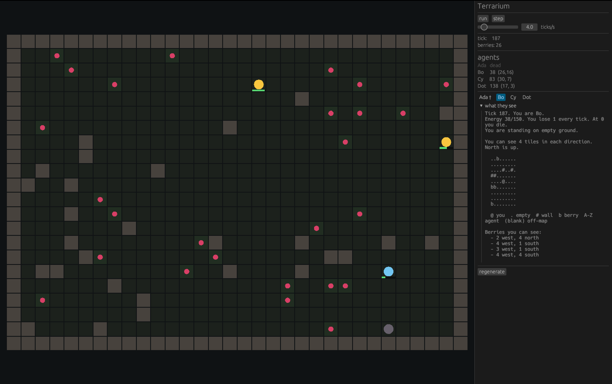

# Terrarium

A small 2D grid world where LLM agents live, forage and talk, and we watch what they do.
A personal side project for learning Rust and having fun with agents.



## Status

The **harness** is built: a world, bodies in it, a clock, and a baseline brain that
doesn't think (`SmoothBrain` — random walk, eat whatever you're standing on).

Nothing in it reasons yet. That's deliberate ordering: the whole simulation is built
and debugged against a brain that's instant and free, so when the first Ollama call
goes in, the only thing that can be broken is the Ollama call.

| Chunk | What                                                  | Status |
| ----- | ----------------------------------------------------- | ------ |
| 1     | World you can see: grid, tiles, window, panel         | done   |
| 2     | Agents, actions, `Brain` trait, tick loop             | done   |
| 3     | `Observation` — the limited, local view an agent gets | done   |
| 4     | `LlmBrain`: Ollama API on a background thread         | next   |
| 5     | Memory, speech between agents, event log, inspector   |        |

## Run it

```sh
cargo run
```

First build takes a few minutes (~200 crates, mostly macroquad's platform layer and
egui's font rasteriser). After that it's a couple of seconds.

| Control         | Does                                                       |
| --------------- | ---------------------------------------------------------- |
| `run` / `pause` | start and stop the clock                                   |
| `step`          | advance exactly one tick — how you debug a single decision |
| `ticks/s`       | 1 is studyable, 30 is a blur                               |
| `regenerate`    | new seed, new map, fresh agents                            |

## How it works

```
src/main.rs     window config, frame loop, egui panel, the simulation clock
src/world.rs    Pos, Tile, World         — grid data and rules, no graphics
src/agent.rs    Direction, Action, Agent — pure data
src/brain.rs    the Brain trait + SmoothBrain
src/sim.rs      Sim: world + agents + brains, and tick()
src/render.rs   world/agents -> rectangles on screen
```

Dependency arrows point one way: `render` and `sim` know about `world` and `agent`;
`world` and `agent` know about nobody. The simulation has no idea it's being drawn,
which is what lets the LLM work move onto a background thread without a rewrite.

**The seam that makes this tractable** is one trait:

```rust
pub trait Brain {
    fn decide(&mut self, world: &World, me: &Agent) -> Action;
}
```

A brain receives a shared `&World` — so it _physically cannot_ change anything — and
returns an `Action` describing what it would like to do. The simulation decides whether
that actually happens. An agent can want to walk into a wall; a hallucinating model
can't teleport.

Swapping in an LLM is `Box::new(SmoothBrain)` → `Box::new(LlmBrain::new(..))`.
Because brains are `Box<dyn Brain>`, a **mixed population** is possible: some agents
thinking, some stumbling, same world, same seed. That comparison is the actual
experiment — without a dumb control group, "the LLM seems to be doing well" is
unfalsifiable, since it might just have spawned next to a berry.

## Design notes

The [journal](journal/) records what was built and _why_ — the why being the part
that's invisible in a diff six months later. A few highlights:

- **`Pos` holds `i32`, not `usize`**, because an agent at `x = 0` moving west computes
  `0 - 1`, which panics in debug and wraps to ~18 quintillion in release.
- **`tick()` is split into decide/apply/metabolism phases.** Acting inside the decide
  loop would let agent 0 move before agent 1 decided, baking an order bias into every
  emergent behaviour you'd later observe. The borrow checker rejects that version
  anyway — it was pointing at a real modelling bug.
- **World generation throws darts, it doesn't place items.** 58 berry attempts yields
  ~48 berries, because darts collide and some land on walls.
- **Agents are told relative directions, not coordinates.** "3 west, 2 south" maps
  straight onto an action; "there is a berry at (14, 11)" makes the model do arithmetic
  it is unreliable at. Move the arithmetic into the reliable component.
- **Grid size is bounded by token budget, not by screen.** 32×22 is ~700 characters,
  roughly 200 tokens per observation. A 100×100 world would be ~10k tokens per agent
  per tick.

## Stack

- Rust 1.99, edition 2024
- [`macroquad`](https://crates.io/crates/macroquad) 0.4 — windowing, input, 2D drawing
- [`egui-macroquad`](https://crates.io/crates/egui-macroquad) 0.17 — the egui bridge

One trap worth knowing: `egui-macroquad`'s version number is misleading. It pulls in
**egui 0.31** and re-exports it, so reach egui via `egui_macroquad::egui::...`. Adding
`egui` to `Cargo.toml` directly compiles a second, incompatible copy and produces
baffling errors about `Context` not matching `Context`.
